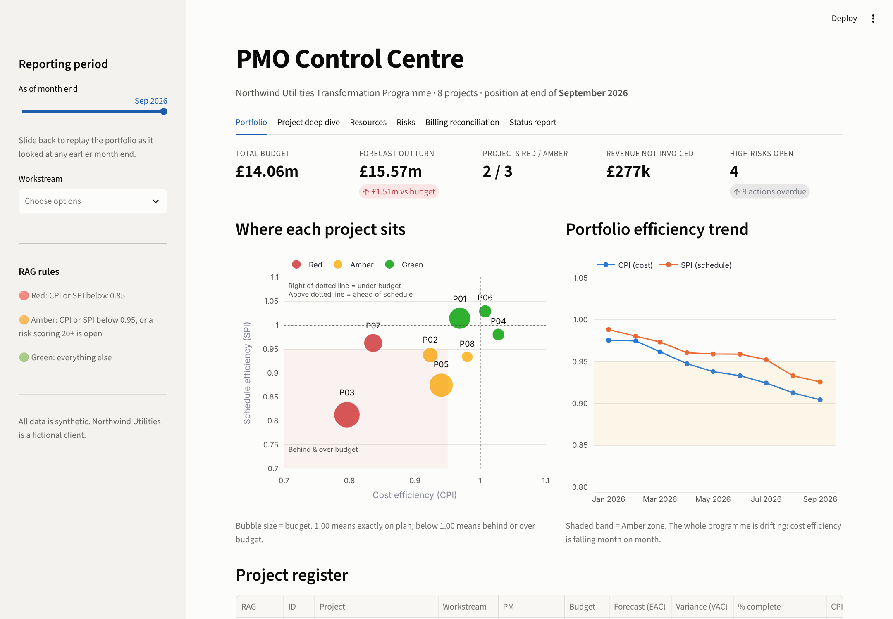
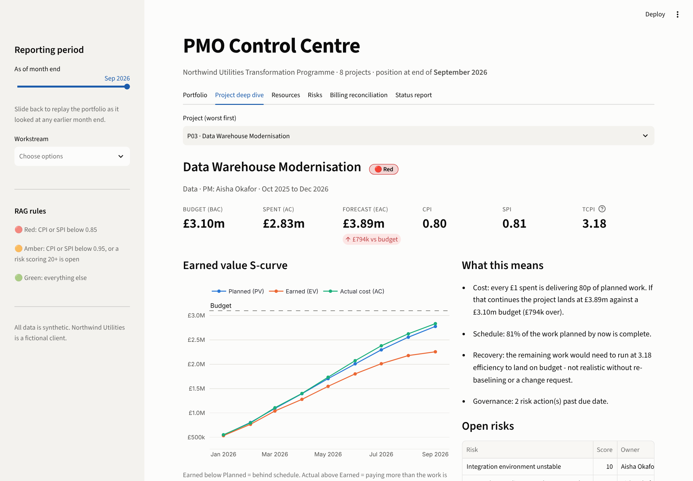
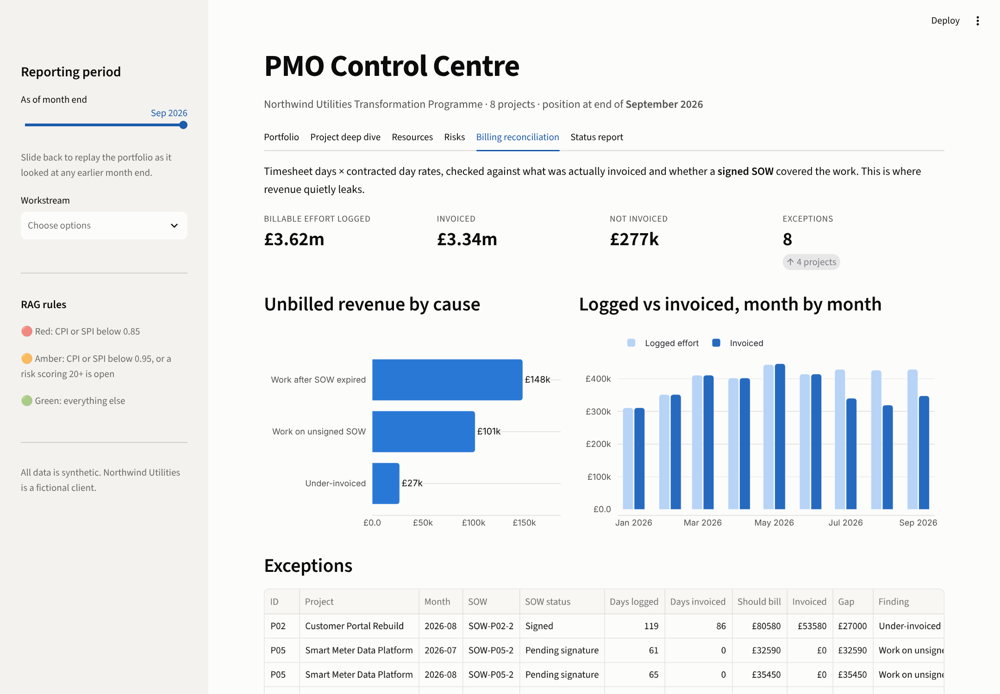
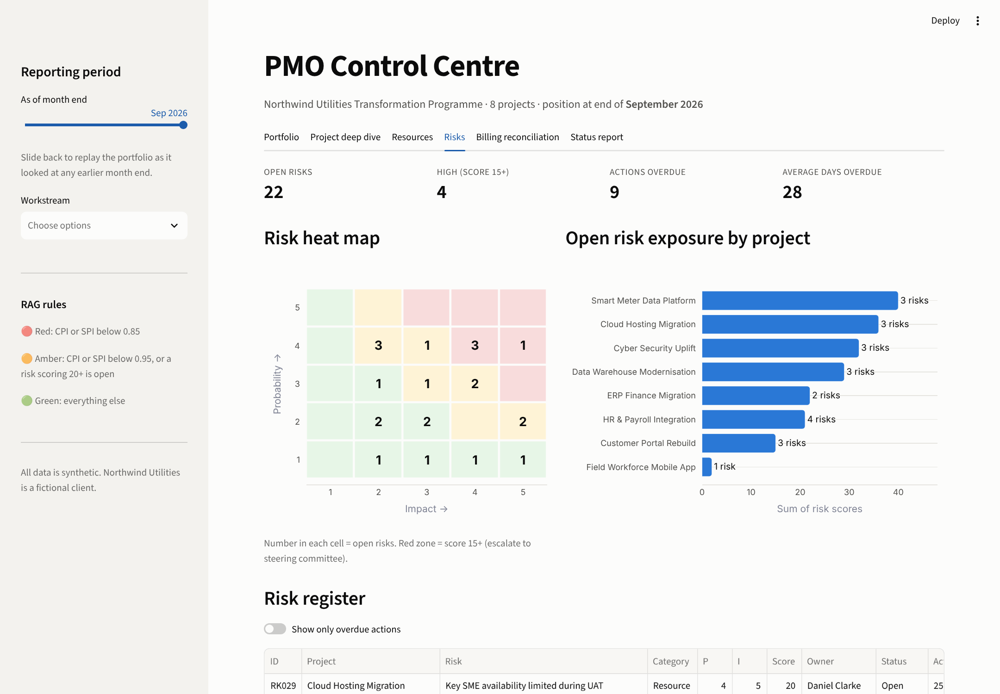
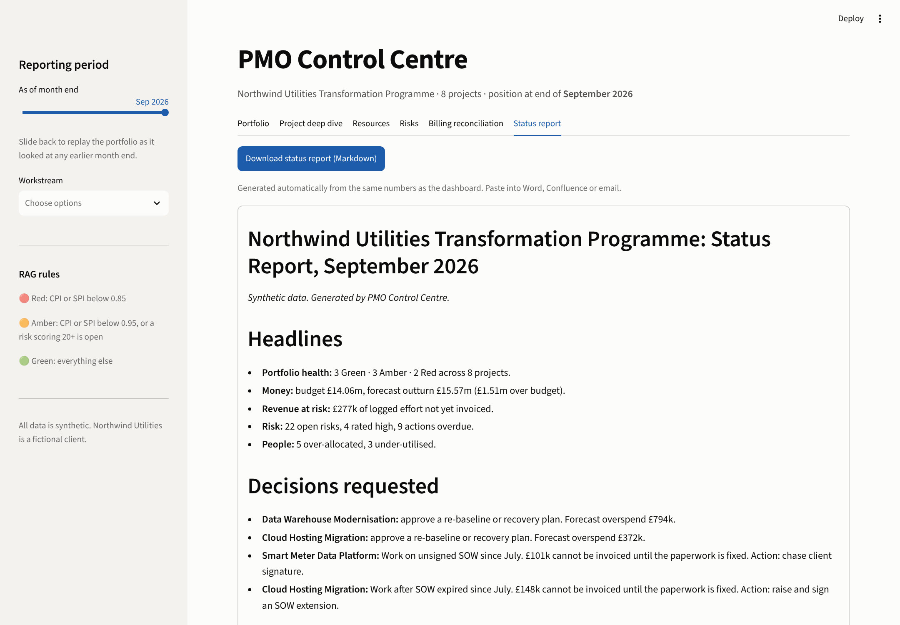

# PMO Control Centre

**A portfolio governance dashboard for an 8-project, £14m transformation programme.** It turns raw project data into the questions a steering committee actually asks:

- *Which projects are in trouble, and how much will they really cost?*
- *Who on the team is burning out, and who is sitting idle?*
- *Which risks need escalating, and whose actions have slipped?*
- *Is all the work we're doing actually being billed?*

Then it writes the monthly status report automatically.



> All data is synthetic. "Northwind Utilities" is a fictional client. The scenarios are modelled on problems I dealt with in real PMO roles.

---

## Why I built this

In PMO roles I spent a lot of time pulling the same numbers from timesheets, trackers, SOWs and invoices into status packs by hand. The most valuable finding I ever made was the least glamorous: revenue gaps that traced back to **projects starting before their Statements of Work were signed**. The work was being done, but nobody could bill for it.

This project automates that kind of control. One engine calculates earned value, utilisation, risk exposure and billing gaps. A dashboard shows the results, and a generator writes the board report from the same numbers, so the slides and the spreadsheet can never disagree.

## What it does

| Tab | What a PMO lead gets from it |
|---|---|
| **Portfolio** | RAG status for every project, a CPI vs SPI quadrant (bubble = budget), the programme efficiency trend and the full project register |
| **Project deep dive** | Earned-value S-curve, forecast outturn, a plain-English explanation of what the numbers mean, open risks |
| **Resources** | Utilisation heat map for 42 people across 9 months, with over-allocation (>100%) and bench (<60%) exceptions and how long each has persisted |
| **Risks** | 5×5 probability × impact heat map, exposure by project, overdue-action tracking |
| **Billing reconciliation** | Timesheet days × day rates, checked against invoices and SOW coverage. Flags under-billing, over-billing, unsigned SOWs and expired SOWs |
| **Status report** | A steering-committee pack generated automatically: headlines, decisions requested, project table, commentary, top 5 risks. Downloads as Markdown |

**Time travel:** the sidebar slider replays the whole portfolio as it looked at any month end, which shows how problems develop over time.

| | |
|---|---|
|  |  |
|  |  |

## What it found in the sample data

The generator plants realistic problems. The dashboard finds every one of them, and the test suite checks this:

- **Data Warehouse Modernisation is Red.** CPI 0.80 means every £1 spent buys 80p of work. Forecast outturn is £3.89m against a £3.10m budget. To finish on budget, the remaining work would have to run at a TCPI of 3.18, which is not credible, so the report asks for a re-baseline decision.
- **Cloud Hosting Migration's SOW expired in June**, but the team kept working. That leaves **£148k of effort that cannot legally be invoiced** until an extension is signed.
- **Smart Meter Data Platform phase 2 started on an unsigned SOW**, leaving £101k stuck.
- Two consultants were **left off an invoice** in August (£27k), and one client was **over-billed** (credit note needed).
- Four people have been **booked at 120–145% for five months running**, while three others have sat below 50% for four months.

## The numbers, in plain English

| Metric | Formula | Meaning |
|---|---|---|
| **CPI** (cost performance) | EV ÷ AC | Value delivered per £1 spent. 0.90 = 90p of work per £1 |
| **SPI** (schedule performance) | EV ÷ PV | Share of the planned work actually done |
| **EAC** (estimate at completion) | BAC ÷ CPI | Final cost if current efficiency continues |
| **VAC** (variance at completion) | BAC − EAC | Forecast over/underspend |
| **TCPI** (to-complete index) | (BAC − EV) ÷ (BAC − AC) | Efficiency needed from now on to land on budget. Above ~1.10 is rarely achievable |

**RAG rules** (one place to change them: `pmo/metrics.py`)
- 🔴 **Red:** CPI or SPI below 0.85
- 🟠 **Amber:** CPI or SPI below 0.95, or a risk scoring 20+ is open
- 🟢 **Green:** everything else

*Actual cost includes non-labour spend (licences, infrastructure, suppliers), so it is larger than the labour-only billing figures.*

## Run it yourself

```bash
git clone https://github.com/Divyaprakash-SM/pmo-control-centre.git
cd pmo-control-centre
pip install -r requirements.txt
streamlit run app.py
```

Optional:

```bash
python -m pmo.generate_data   # rebuild the sample data (seeded, so the output is identical every time)
pytest                        # 17 tests: formulas, RAG rules, and that every planted issue is detected
```

## How it's built

```
pmo-control-centre/
├── app.py                  # Streamlit dashboard (presentation only)
├── pmo/
│   ├── generate_data.py    # seeded synthetic programme: projects, EVM, people, risks, SOWs, invoices
│   ├── metrics.py          # the engine: EVM, RAG, utilisation, risk scoring, billing reconciliation
│   └── report.py           # writes the steering-committee status report
├── data/                   # 8 CSV tables (what a PMO would export from Jira / MS Project / finance)
├── tests/                  # pytest suite
└── docs/screenshots/
```

**Design choices**
- **Calculations are kept separate from the display.** `metrics.py` has no dashboard code, so the same logic could feed a scheduled email, Power BI or an Excel export.
- **Data is relational, as it is in real life.** Timesheets, allocations, SOWs and invoices are separate tables joined on project, person and month, the way they would come out of separate systems.
- **Colour is used with discipline.** Red, amber and green appear only for status, and always with a label or icon so colour is never the only signal. Data series use a separate, colour-blind-checked palette.

**Stack:** Python · pandas · NumPy · Plotly · Streamlit · pytest

## Deploy free on Streamlit Community Cloud

1. Push this repo to GitHub.
2. Go to [share.streamlit.io](https://share.streamlit.io), sign in with GitHub, click **Create app**.
3. Pick this repo, branch `main`, main file `app.py`, then **Deploy**.
4. Put the live link at the top of this README and on your CV.

## Roadmap

- Import real exports from Jira / MS Project / Monday.com in place of the generator
- Monte Carlo forecast ranges for EAC (P50 / P80), building on my [MSc cost-risk model](https://github.com/Divyaprakash-SM/Monte-Carlo-Simulation)
- Export the status pack to PowerPoint

---

**Divyaprakash S M** · PMP · PRINCE2 Agile Practitioner · MSc Business Analytics (University of Southampton)
